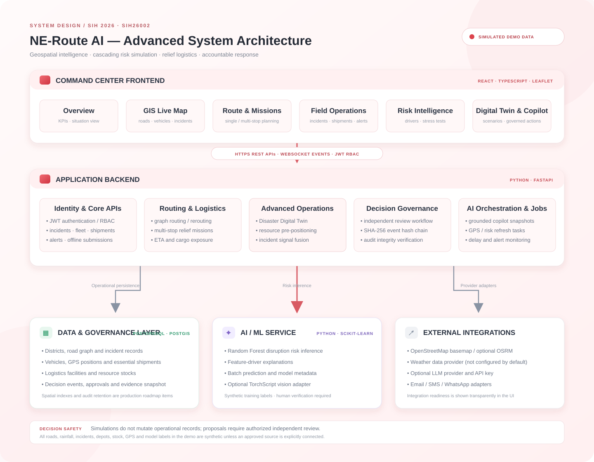

# NE-Route AI

**Intelligent Logistics & Accessibility Command Center for North East India**  
SIH 2026 · Problem Statement SIH26002 · Prototype implementation

NE-Route AI is a hackathon-ready decision-support prototype for visualizing simulated road disruption, assessing corridor risk, comparing route alternatives, tracking synthetic essential-supply shipments, and coordinating field incident reports.

> **Important:** This repository is a demonstration system. Its road graph, GPS positions, rainfall features, incidents, shipments, risk training data and displayed operational conditions are synthetic. The OpenStreetMap layer is a basemap; the overlaid route geometry is not authoritative. Do not use these routes, risk scores, or ETA values for real-world dispatch. No restricted government data is accessed.

## What is implemented

- White / light-red React + TypeScript command-center UI with a dedicated Predictive Risk Intelligence workspace.
- FastAPI backend with JWT authentication and role checks.
- PostgreSQL + PostGIS persistence for roads, incidents, vehicles, and report locations.
- Seeded illustrative NER graph and demo accounts.
- Leaflet basemap with simulated road risk, incidents and vehicle positions.
- Separate scikit-learn Random Forest ML service trained on generated synthetic data.
- Fastest, safest and cargo-priority route scoring using NetworkX.
- Shipment and vehicle APIs, alerts and incident verification workflow.
- WebSocket simulated GPS movement.
- Platform-grounded copilot with deterministic fallback and optional OpenAI API connection.
- Operations-wide CSV export, risk distribution and explainability panel, fleet GPS freshness monitoring, prioritized response recommendations, platform readiness reporting and non-persistent rainfall / bridge stress-test scenarios.
- Incident image upload storage. Vision classification intentionally returns manual-review-required until a trained, validated classifier is installed.
- Disaster Digital Twin: non-persistent compound-hazard stress tests, network fragmentation, cascading shipment impact, district accessibility loss and illustrative recovery trajectories.
- Strategic relief pre-positioning: risk-adjusted hub-to-district allocation proposals for medical kits, food packs, relief kits, road-repair kits and fuel.
- Spatial-temporal incident fusion: duplicate-candidate clustering and source-corroboration signals with human review.
- Append-only SHA-256 decision journal with independent approval workflow and chain-integrity verification.
- System Health & Diagnostics workspace with live database, PostGIS, ML service and configuration probes.
- Docker Compose stack and GitHub Actions CI workflow for backend, ML and frontend checks.

## Architecture



*System overview: React / Leaflet frontend → FastAPI application backend → PostgreSQL / PostGIS and the separate AI/ML service, with optional external integrations. All demonstration telemetry and predictions are explicitly marked as simulated.*

[Open the architecture diagram separately](docs/architecture.svg).

## Prerequisites

- Docker Desktop with Docker Compose v2 (recommended), or Docker Engine + Compose plugin.
- At least 4 GB available RAM for the database, Python services and frontend build.
- Internet access during first startup for container images, Python packages, npm packages and OpenStreetMap tiles.

## Quick start (recommended)

1. Clone or extract the repository and enter the project directory.
2. Copy environment defaults:

   ```bash
   cp .env.example .env
   ```

   On Windows PowerShell:

   ```powershell
   Copy-Item .env.example .env
   ```

3. Start all services:

   ```bash
   docker compose up --build
   ```

4. Open:

   - Frontend: http://localhost:5173
   - API docs: http://localhost:8000/docs
   - Backend liveness: http://localhost:8000/health
   - Backend readiness (database + ML): http://localhost:8000/health/ready
   - ML health: http://localhost:8100/health

The first ML startup generates and trains a synthetic Random Forest model. The API creates relational tables and seeds the synthetic demonstration dataset when `DEMO_MODE=true`. PostGIS is enabled when the database supports it, but the current prototype can start without the extension because coordinates are stored as JSON. The frontend is built as a production static bundle and Nginx proxies `/api` and `/health` to FastAPI. The Vite development server also proxies those paths to the local API. First startup can take several minutes depending on network and hardware.

## Demo accounts

| Role | Email | Password |
|---|---|---|
| Administrator | `admin@neroute.ai` | `Admin@123` |
| Government official | `official@neroute.ai` | `Official@123` |
| Logistics manager | `logistics@neroute.ai` | `Logistics@123` |
| Field officer | `field@neroute.ai` | `Field@123` |

These are public demo credentials and are created only when `DEMO_MODE=true`. Do not use them on a shared or deployed environment. Set `DEMO_MODE=false` and a unique high-entropy `JWT_SECRET` before non-demo deployment.

## Suggested 3-minute demo

1. Sign in as `admin@neroute.ai` and show the regional KPI cards, district accessibility chart and field intelligence feed.
2. Open **Live Map**. Explain the green/yellow/orange/red corridor risk legend, field incidents and simulated vehicle positions.
3. Open **Shipments** and highlight critical medicine shipment `MED-204` and its delivery deadline.
4. Open **Risk Intelligence**. Review the resilience index, explainable corridor watchlist, cargo exposure and system readiness. Run a rainfall / bridge-vulnerability what-if scenario.
5. Return to **Overview** and click **Simulate landslide**. The synthetic Guwahati–Dimapur corridor is marked closed and a critical alert is created.
6. Open **Route Planner**, keep Guwahati → Imphal and Critical cargo, and calculate the three route strategies. The blocked segment is excluded from the route graph.
7. Open **Alerts**, acknowledge or resolve the generated route-closure alert.
8. Open **AI Copilot** and ask: “Which corridors are blocked?” or “Which medicine shipments are delayed?” The copilot uses a current platform-data snapshot and labels it simulated.
9. Open **Mission Control**. Select multiple delivery locations and run a critical-cargo relief mission. Explain the heuristic stop order, total ETA, distance and risk index.
10. Generate a landslide / critical response playbook, assign attention to the responsible roles and tick completed checklist steps. Explain that this is a configurable template, not an official SOP.
11. Open **Overview** and click **Reset scenario** to restore the demo graph and recalculate active shipment ETAs.
12. Open **Incidents** and verify or reject a pending field report.

## API endpoint summary

All application endpoints use `/api/v1` and require `Authorization: Bearer <token>` except login.

| Method | Endpoint | Purpose |
|---|---|---|
| POST | `/auth/login` | Obtain JWT |
| GET | `/auth/me` | Current user |
| GET | `/dashboard/summary` | KPIs and district accessibility |
| GET | `/map/geojson` | Road, incident and vehicle features |
| GET | `/districts` | District reference list |
| GET | `/risks/segments` | Explainable road-segment risk predictions |
| GET | `/weather/observations` | Stored weather features (synthetic in demo) |
| GET/POST | `/incidents` | List or submit field reports |
| POST | `/incidents/{id}/media` | Upload incident evidence |
| PATCH | `/incidents/{id}/status` | Verify, reject or resolve report |
| GET | `/vehicles` | Vehicle list |
| GET | `/shipments` | Shipment list |
| POST | `/routes/plan` | Fastest/safest/priority route options |
| POST | `/offline/sync` | Idempotently sync queued field reports |
| GET | `/alerts` | Alert inbox |
| PATCH | `/alerts/{id}` | Acknowledge, assign or resolve |
| POST | `/copilot/ask` | Ask platform-grounded assistant |
| GET | `/analytics/intelligence` | Network, cargo, fleet and response intelligence snapshot |
| POST | `/analytics/scenario` | Non-persistent rainfall / bridge what-if projection |
| POST | `/missions/optimize` | Risk-aware multi-stop relief mission sequencing |
| POST | `/response/playbook` | Generate hazard- and severity-specific response checklist |
| GET | `/analytics/export.csv` | Download combined operations CSV |
| GET | `/system/readiness` | API, ML, weather, notification and human-approval readiness |
| POST | `/demo/trigger-disruption` | Trigger seeded landslide scenario |
| POST | `/demo/reset` | Restore simulated closure state while retaining history |
| POST | `/advanced/digital-twin/run` | Compound disruption digital twin and cascading impact projection |\n| POST | `/advanced/resource-staging/plan` | Risk-adjusted multi-hub relief allocation proposal |\n| GET | `/advanced/incident-fusion/analyze` | Spatial-temporal duplicate candidate and corroboration analysis |\n| POST | `/advanced/decisions/propose` | Record an operational proposal for independent review |\n| POST | `/advanced/decisions/{proposal_id}/review` | Append an authorized approval / rejection event |\n| GET | `/advanced/decisions` | Decision proposal and review history |\n| GET | `/advanced/decisions/integrity` | Verify SHA-256 journal chain |\n| WS | `/api/v1/ws/live?token=...` | Simulated GPS updates |

## Example API calls

Login:

```bash
curl -X POST http://localhost:8000/api/v1/auth/login \
  -H 'Content-Type: application/json' \
  -d '{"email":"admin@neroute.ai","password":"Admin@123"}'
```

Plan a route (replace TOKEN):

```bash
curl -X POST http://localhost:8000/api/v1/routes/plan \
  -H 'Authorization: Bearer TOKEN' \
  -H 'Content-Type: application/json' \
  -d '{"origin":"Guwahati","destination":"Imphal","cargo_priority":"CRITICAL"}'
```

Ask the copilot:

```bash
curl -X POST http://localhost:8000/api/v1/copilot/ask \
  -H 'Authorization: Bearer TOKEN' \
  -H 'Content-Type: application/json' \
  -d '{"question":"Which medicine shipments are delayed?"}'
```

## Advanced risk intelligence

The **Mission Control** workspace adds a multi-stop delivery optimizer. It computes pairwise priority-aware legs, applies a deterministic nearest-neighbour stop ordering and a 2-opt local-improvement pass, and reports unreachable stops, total distance, ETA and route exposure. It is a heuristic and does not claim a globally optimal vehicle-routing solution. The same page generates hazard-specific response checklists with role ownership, evidence requirements, severity-based escalation and safety guardrails. Checklist ticks are local UI state only; they do not record official completion or dispatch orders.

The **Risk Intelligence** workspace includes: network resilience heuristic, current risk-band distribution, ranked corridor exposure with feature-driver explanations, medicine / critical cargo exposure, last-GPS freshness checks, a prioritized response queue, service-readiness inventory, non-persistent rainfall and bridge-vulnerability stress tests, and combined operations CSV export. Scenario projections do not alter stored operational state.

## Digital Twin & Strategic Response\n\nThe advanced workspace connects four capabilities: (1) non-persistent disaster digital-twin scenarios that calculate cascading road, shipment and district effects; (2) resource pre-positioning recommendations from synthetic regional hubs; (3) spatial-temporal incident corroboration to surface possible duplicate reports; and (4) an append-only, hash-chained decision journal with independent reviewer controls. See [Advanced Operations documentation](docs/advanced-operations.md).\n\nThese features are decision-support prototypes. They do not issue official road closures, dispatch vehicles, move inventory, publish public alerts or automatically merge reports. The road graph, facility stocks and scenario parameters are synthetic.\n\n## Tests\n
Install backend and ML dependencies using the Dockerfiles or a Python virtual environment. Run:

```bash
make test
```

This runs backend unit/service/schema tests, ML synthetic-data training tests and dependency-free frontend core tests. With the backend running at `http://localhost:8000`, run the Vite frontend in development mode with `cd frontend && npm install && npm run dev`. Vite proxies `/api` and `/health` to FastAPI. For the production container stack, use the Docker Compose command above.\n\nWith frontend npm dependencies installed, run:

```bash
cd frontend
npm install
npm test
npm run build
```

`make test-full` runs all suites when frontend dependencies are installed. The latest [GitHub Actions CI run](https://github.com/hemanthkumar1012/NE-Route-AI/actions/runs/43588696127) passed: 28 backend tests, 2 ML tests, 5 frontend core tests, 8 React component tests, the Vite production build, Docker Compose configuration validation, and backend / ML / frontend Docker image builds (43 tests total). See [Advanced v4 test results](TEST_RESULTS_ADVANCED.md). A live PostgreSQL/PostGIS Compose startup was not included in that CI run.\n\n**Dependency security note:** the CI `npm install` audit summary reported 6 advisories (3 moderate, 1 high, 2 critical). Run `cd frontend && npm audit` and review the affected dependency paths before deployment. Avoid applying `npm audit fix --force` without checking for breaking upgrades.

## Data and deployment safety

- Demo accounts and passwords are public and must only be used locally.
- Configure a high-entropy `JWT_SECRET` before deployment.
- Synthetic feature relationships are for demonstrating explainable workflows, not validated disaster forecasts.
- Install only a validated TorchScript incident-image model; until then image uploads require human verification.
- Weather, SMS, WhatsApp, email and map tile providers are not represented as connected unless explicitly configured.
- Keep human verification and authorized dispatch approval in the operational loop.
- Respect OpenStreetMap tile usage policy and attribution; use a suitable tile provider or offline tile package for production / disconnected deployments.

## License

Add a project license before public reuse or distribution. Contributions should include tests and preserve the synthetic-data disclaimers.
