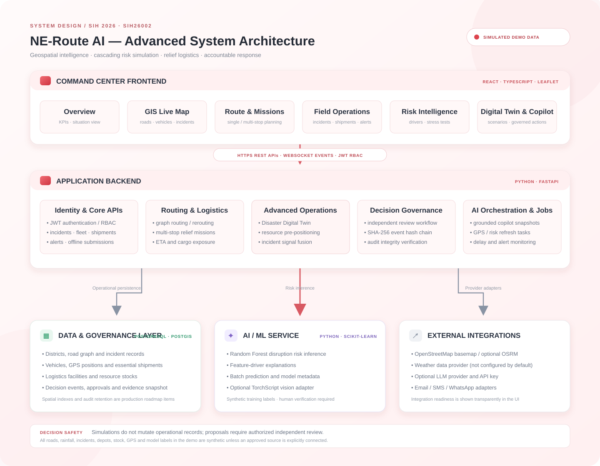

# NE-Route AI architecture

The React / TypeScript + Leaflet command center calls a FastAPI application through REST and WebSocket channels. FastAPI owns authentication, role-based permissions and business workflows. PostgreSQL / PostGIS stores operational records. A separate scikit-learn ML service performs synthetic-data disruption-risk inference and provides an optional fail-closed image-classification adapter.

## Application services

- **Identity and core APIs:** JWT authentication, user roles, incidents, shipments, fleet, alerts and offline report intake.
- **Routing and logistics:** graph path selection, priority-aware route comparisons, multi-stop relief missions and shipment impact.
- **Advanced operations:** Disaster Digital Twin scenario projection, strategic relief resource staging and incident signal fusion.
- **Decision governance:** append-only proposal / review events with a SHA-256 hash chain and integrity verification.
- **Background processing:** simulated GPS updates, periodic risk refresh and delay / alert checks.

## Data and external boundaries

The prototype stores road links and geographic coordinates in the demonstration schema. It does not ship an authoritative NER road graph or government boundary layer. OpenStreetMap is used as a basemap; no claim is made that the illustrative overlay or route graph is suitable for navigation. Weather, SMS, WhatsApp and external LLM providers are optional and must be clearly identified as configured or unavailable.

## Operational safeguards

- Simulation endpoints return explicit simulated-data labels and do not mutate records.
- Resource staging is advisory and does not decrement inventory or create transfer orders.
- Incident similarity highlights possible duplicate reports but never merges or rejects records.
- Decision proposals require independent role-authorized review. An approval event records governance status only; it does not dispatch vehicles or publish advisories.
- Synthetic ML holdout metrics do not establish real-world predictive performance.
